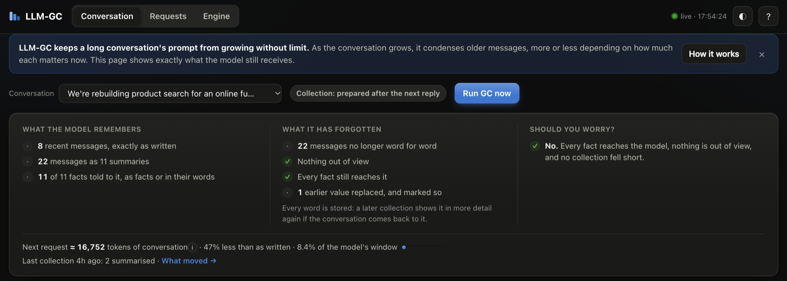
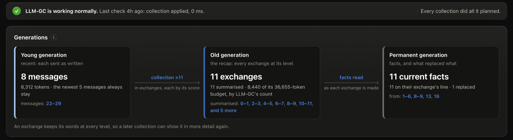
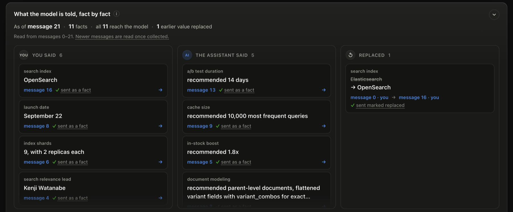

# LLM-GC: Garbage Collection for LLM Context

**See what your model remembers, what it has forgotten, and when to worry.**

If you've spent 50+ turns in a Claude Code session, you've probably watched the model start forgetting things: the database you agreed on, the approach you picked, the thing you said *not* to do. It's all still in the conversation, buried under 130K tokens of old file reads, stale command output and settled debates. Every request re-sends all of it, so you pay for the noise on every call, and the model answers in the same confident tone whether the decision is still in view or not.

LLM-GC sits between your app and the provider and manages the conversation the way a generational garbage collector manages memory. Recent turns stay word for word. Each older exchange is quoted whole, summarised, or archived to its opening line and the facts it established, depending on how much it matters now, and it gets its detail back when the conversation returns to it. Nothing is deleted. The next request carries one compact recap instead of the whole history.

**And it never does this silently:** a live dashboard shows, for every turn, exactly what the model still receives, so you can see when its grounding has gone.



> **Status: work in progress.** What is left before the first release is in [ROADMAP.md](ROADMAP.md).

To run it with Claude Code, follow [Get started](#get-started): five steps, about ten minutes.

**Contents**

- [How it works](#how-it-works)
- [What the dashboard shows](#what-the-dashboard-shows)
- [Get started](#get-started)
- [Other ways to run it](#other-ways-to-run-it)
- [Configuration](#configuration)
- [Results so far](#results-so-far)
- [Why it is built this way](#why-it-is-built-this-way)
- [Developing LLM-GC](#developing-llm-gc)
- [Documentation](#documentation)

## How it works

LLM-GC is a proxy. It forwards every request at once, with the conversation as it is currently condensed. The condensing itself happens after the reply, in the background, so no request ever waits for it:

```
              every request: forwarded at once, no model call
 your app ─────────────────────────►  LLM-GC  ─────────────────────────►  provider
          ◄─────────────────────────    │     ◄─────────────────────────
                                        │ after each reply, in the background
                                        ▼
                         GC pass: is a collection worth making?
                         if so, prepare one: group → score → plan → condense
                         and switch it in at a later request, when that is cheap
```

Most passes find too little to collect and change nothing. Once enough older turns have gone quiet, a pass prepares a **collection**:

1. **Group.** The turns that have aged out of the newest messages become **spans**, one per exchange: a user's message and everything up to their next one.
2. **Score.** Every span, new and old, is scored by how much it matters *now*: recent, or about what the user is discussing, lifted by the decisions and specifics it states.
3. **Plan.** Each span gets a **detail level** from its score: quoted whole, summarised, or archived to its opening line and facts.
4. **Condense.** Each new span is summarised, one model call each, and further calls read the facts its turns settled and file them under the topic they change.

The model then receives one **recap** of every span at its level, followed by the newest messages exactly as sent:

```
 What your app sends:   t0 t1 … t5 "we'll use Postgres" … t28 [30k tokens of logs] … t57

 What the model gets:   ┌ RECAP: one message ───────────────────────────────────────┐
                        │ [Archived]        turns 0–1     opening line · facts      │
                        │ [Quoted exactly]  turns 5–6     every word                │ ← discussed now
                        │ [Summarised]      turns 28–31   opening line · facts · …  │ ← gone quiet
                        └───────────────────────────────────────────────────────────┘
                        t53 t54 t55 t56 t57   ← the newest messages, as sent
```

**What is condensed, and what is not.** An agent's tool calls and their results are part of the conversation: they are scored, summarised and quoted like words, so old file reads and command output are condensed too. The client's own instructions are not: its system prompt, its tools, and the instructions it writes into messages (Claude Code's CLAUDE.md, memory and `<system-reminder>` blocks) reach the model word for word with every request. With Claude Code, LLM-GC also passes its other calls, such as token counting, through untouched; it records and shows Claude Code's subagents but sends them as written, unless `collect_subagents` is on.

**When a collection takes effect.** Rewriting the start of the prompt makes the provider cache it again, which costs money. So a prepared collection is switched in only when that is cheap or needed: when the provider's cache has expired anyway, when the saving repays caching the prompt again, or when the model carries too much that has gone quiet. Between collections the start of the prompt does not change, so the cache stays valid. The details are in [when to collect](doc/design/generational-memory/when-to-collect.md).

### Generations and detail levels

Context is held in three generations, as in a generational garbage collector:

| Generation | What it holds | Analogy |
|---|---|---|
| **Young** | The newest messages, sent word for word | Java's young (eden) space |
| **Old** | Older exchanges as spans, each keeping its original turns and shown at a detail level | Java's tenured generation |
| **Permanent** | Facts read from every span, and what later replaced them; never discarded | Java's permanent generation |



Every span in the old generation is shown at one of four levels, and each level shows everything the one below it shows:

```
 level         what the model reads in the recap
 ───────────   ─────────────────────────────────────────────────────
 kept          [Quoted exactly]  every word of the exchange               ▲ more detail
 summarised    [Summarised]      its opening line · its facts, a summary  │
 archived      [Archived]        its opening line · its facts             │
 out of view   [Out of view]     one line for a run of the oldest spans   ▼ fewer tokens
```

**The score decides the level, and one budget caps the total.** A span scoring 0.7 or more is kept, 0.3 or more summarised, and below that archived. Levels are decided again at every collection, so a span the conversation returns to rises again, from its own words. The recap may spend 30% of the model's window; over that, the coldest spans lose detail first. **Out of view** is only the floor under that budget: when even one archived line per exchange no longer fits, around two thousand exchanges at the default budget, the oldest are folded behind one line saying they exist, and each still keeps its words. When a later turn replaces a decision ("we moved from Google Cloud to AWS"), the older span carries a note saying so, so the model does not read the old decision as current.

How the pieces fit together, with every component on the request path and in the background, is in the [architecture overview](doc/overview.md#how-the-system-is-structured).

## What the dashboard shows

A model has no reliable sense of when its grounding has gone weak, so it cannot be relied on to say so. A person can judge whether to trust an answer, but only with the data to judge from. The dashboard is that data, live, for each conversation:

- **Conversation** opens with three answers: what the model remembers, what it has forgotten, and whether you should worry. Below them: every fact the model is told, with who stated it, the message it came from, how it reaches the model and what replaced it; a map of the whole conversation by how much of each message the model has; and every exchange beside exactly what the model reads for it.
- **Requests** traces a Claude Code session turn by turn, with what each request cost by the provider's own count.
- **Engine** shows LLM-GC at work: the three generations, how each exchange scores against the level lines, every check and collection, anything a collection could not do and what the model got instead, and what the next collection is waiting for.



Hover any ⓘ for a short meaning, and click it, or **?**, for the full explanation. **Run GC now** makes a collection for the selected conversation at once.

There is deliberately **no single "health score" or "hallucination risk" number.** A number labelled "risk" claims an accuracy no heuristic can back without real hallucination labels, and a misleading number would be one more black box. Each signal is named for what it measures, and a collection that failed or was skipped is shown, never hidden. The reasoning is in [visibility](doc/design/visibility/overview.md).

## Get started

LLM-GC is a small server that runs on your machine. You point Claude Code at it, and it passes each request on to Anthropic, or to your company's gateway, with the conversation condensed:

```
 Claude Code ─────────────────►  LLM-GC  ─────────────────►  Anthropic, or your
             ANTHROPIC_BASE_URL   :9900   upstream           company's gateway
             in Claude Code's       │     in llm-gc.toml
             settings (step 4)      │     (step 2)
                                    └──►  dashboard :9901, in your browser
```

Each arrow is set in its own place. `upstream` is where LLM-GC sends requests on: Anthropic by default, or your gateway, set in step 2. `ANTHROPIC_BASE_URL` is where Claude Code sends them, and step 4 sets it to LLM-GC. Until then, in either setup, Claude Code doesn't know LLM-GC exists.

**Two credentials, two jobs:**

| | Used for | Where it lives |
|---|---|---|
| **Claude Code's login** | Your conversation. Passed on untouched, never stored | In Claude Code, as now. You change nothing |
| **LLM-GC's own key** | Only LLM-GC's own short calls: summarising old exchanges and reading their facts. Never your conversation. Billed to that key | LLM-GC's `.env` file, set up in step 2 |

LLM-GC can't borrow Claude Code's login, so you give it a key of its own. Behind a company gateway, it can be the same token Claude Code uses. The model LLM-GC calls is its own choice too, separate from the one you talk to: `model` under `[summary]` in `llm-gc.toml` (see [Configuration](#configuration)).

> **Just want to look first?** [Without a key](#without-a-key) runs the dashboard on scripted conversations, with no key and no Claude Code.

### Which setup are you?

Run this. It prints a line only if Claude Code is pointed at a gateway:

```bash
grep ANTHROPIC_BASE_URL ~/.claude/settings.json
```

| It prints | Your setup | What LLM-GC needs |
|---|---|---|
| Nothing, or *No such file* | **Direct.** Claude Code talks to Anthropic, with a Claude Pro or Max login or with an API key | An Anthropic API key from [console.anthropic.com](https://console.anthropic.com). A Pro or Max subscription doesn't include one: the Console bills it separately |
| A line with a URL | **Gateway.** Your company routes Claude through its own address | That address, a model name and a token, all copied from `~/.claude/settings.json` in step 2 |

If Claude Code runs on Amazon Bedrock or Google Vertex AI, LLM-GC can't sit in front of it yet.

### 1. Install

You need [uv](https://docs.astral.sh/uv/getting-started/installation/) (`brew install uv`, or `curl -LsSf https://astral.sh/uv/install.sh | sh`). It installs Python 3.13 for you if you don't have it.

```bash
git clone https://github.com/rshmie/llm-gc.git
cd llm-gc
uv sync --extra proxy --no-dev   # creates .venv and installs LLM-GC into it, with the web server it runs on
source .venv/bin/activate        # puts the llm-gc command on this terminal's PATH
llm-gc --version                 # prints its version: the install worked
```

`--extra proxy` adds the web server, the dashboard and the settings loader. They are optional so that a program using LLM-GC only as a library does not install them; without them, `llm-gc` tells you what is missing. `--no-dev` leaves out the tools for working on LLM-GC itself.

Every new terminal needs `source .venv/bin/activate`, run in the LLM-GC folder, before `llm-gc` works.

### 2. Configure LLM-GC

In the LLM-GC folder:

```bash
llm-gc config init       # writes llm-gc.toml: LLM-GC's settings, each one commented
cp .env.example .env     # .env holds LLM-GC's key
```

Both files stay in this folder, and git ignores both. `llm-gc` reads them from the folder you start it in, so always start it from here.

#### Direct

Claude Code calls Anthropic's API itself, with your Pro or Max login or an API key. LLM-GC forwards to Anthropic by default, so all it needs is its own key.

Open `.env` and put your API key on the `ANTHROPIC_API_KEY` line:

```bash
ANTHROPIC_API_KEY=sk-ant-...
```

Leave `llm-gc.toml` as it is, and go on to [check the setup](#check-the-setup).

#### Gateway

Claude Code calls your company's own address, which passes requests on to Anthropic. LLM-GC goes between Claude Code and that gateway, and sends its own calls there too:

```
Claude Code ──►  LLM-GC  ──►  your company's gateway  ──►  Anthropic
```

Open `~/.claude/settings.json` and copy three values from its `env` block:

| Copy from `~/.claude/settings.json` | Into | Like this |
|---|---|---|
| `ANTHROPIC_BASE_URL`, the gateway's address | `llm-gc.toml`: the `upstream` line under *Proxy*. Delete the `#` in front of it | `upstream = "https://…"` |
| A model name, from an entry ending in `_MODEL` such as `ANTHROPIC_DEFAULT_SONNET_MODEL` | `llm-gc.toml`: the `model` line under `[summary]`. Delete the `#` in front of it | `model = "…"` |
| `ANTHROPIC_AUTH_TOKEN` (or `ANTHROPIC_API_KEY`) | `.env`: the line with the same name | `ANTHROPIC_AUTH_TOKEN=…` |

Gateways sometimes name models their own way and refuse LLM-GC's default, so set the model name accordingly. Every setting in `llm-gc.toml` starts commented out at its default, so the file changes nothing until you edit it. Once edited, the two lines you set look like this, each in its own place in the file:

```toml
upstream = "https://your-gateway.example.com"

[summary]
model = "your-gateway-sonnet-name"
```

Edit the lines that are already there rather than adding new ones at the end of the file: a line added there lands in the last section, `[engine]`, and `llm-gc start` refuses it.

No `_MODEL` entry, or no token in the `env` block (some gateways hand tokens out through a helper script, `apiKeyHelper`)? Ask your gateway team for a model name and a token that LLM-GC can use.

Leave `~/.claude/settings.json` as it is. Step 4 sets LLM-GC's address in your project instead.

#### Check the setup

```bash
llm-gc config show
```

It prints every setting LLM-GC will use and where each came from. A value you changed stands out; one that only repeats its default is dimmed. It ends with LLM-GC's key, never its value. The last line should read `✓ LLM-GC has its own key for anthropic.` Behind a gateway, also check `upstream` and `model`. Step 3 then tests the key for real.

### 3. Start LLM-GC

```bash
llm-gc start --dashboard
```

Before it serves anything, LLM-GC sends one tiny request to the upstream (Anthropic, or your gateway) with its own key and model. A wrong key or model stops it here, with the upstream's own reason, instead of failing quietly later. When all is well, it prints something like:

```
  LLM-GC 0.1.0

  Config     ~/…/llm-gc/llm-gc.toml (working directory)
  Upstream   https://api.anthropic.com
  Summaries  claude-sonnet-5 (the default)
  Check      ✓ the upstream accepted LLM-GC's key and model

  Proxy      http://127.0.0.1:9900
  Dashboard  http://127.0.0.1:9901
  Stats      llm-gc stats (in another terminal)

  Leave this terminal open while you work. Ctrl-C stops LLM-GC.
```

Behind a gateway, `Upstream` and `Summaries` show the gateway's address and your model. The dashboard runs only with `--dashboard`, because it shows your conversations. Without the flag its row says *off*. To have it every time, set `dashboard = true` in `llm-gc.toml`.

Leave LLM-GC running, and open a **second terminal** for the next steps.

### 4. Point Claude Code at LLM-GC

**Both setups need this step.** Claude Code sends each request to the address in its `ANTHROPIC_BASE_URL` setting, or straight to Anthropic when that isn't set. Until it names LLM-GC's address, LLM-GC receives nothing, whatever `llm-gc.toml` says.

Start with one project: a folder you work in with Claude Code, not the LLM-GC folder.

In that project, the setting goes in `.claude/settings.local.json`:

```bash
cd ~/path/to/your-project
mkdir -p .claude
```

If `.claude/settings.local.json` doesn't exist yet, create it with this:

```json
{
  "env": { "ANTHROPIC_BASE_URL": "http://127.0.0.1:9900" }
}
```

If it does exist (Claude Code keeps your permission choices there), add the `env` entry beside what is there, with a comma between the two. If it already has an `env` block, add the `ANTHROPIC_BASE_URL` line inside it instead.

```json
{
  "permissions": { "allow": ["…what is already there…"] },
  "env": { "ANTHROPIC_BASE_URL": "http://127.0.0.1:9900" }
}
```

Then start `claude` in that project. A session that was already running keeps its old address, so restart it.

What this changes, and what it doesn't:

- **Only this project goes through LLM-GC.** Its setting overrides `~/.claude/settings.json`, so your other projects don't change. To stop, delete the `env` entry.
- **Your login stays where it is.** Claude Code still sends it, and LLM-GC passes it on.
- **The file is yours alone, so keep it out of git.** `git check-ignore .claude/settings.local.json` prints the path if git already ignores it. If it prints nothing, add that path to the project's `.gitignore`. Committed, it would point your teammates' Claude Code at an address where nothing answers.

> **Just one session?** In the direct setup, `ANTHROPIC_BASE_URL=http://127.0.0.1:9900 claude` points that one session at LLM-GC, with no file to edit. Behind a gateway it has no effect: the address in `~/.claude/settings.json` wins over the command line.
>
> **Want LLM-GC in all your projects?** Put the same `env` entry in `~/.claude/settings.json` instead of in each project. The catch: every Claude Code session then depends on LLM-GC, so none can connect while it is stopped. Behind a gateway, that file already sets `ANTHROPIC_BASE_URL` to the gateway's address. Change that value to LLM-GC's address, after copying the gateway's address into `upstream` in step 2.

### 5. Check that it works

Send Claude a message. LLM-GC's terminal prints a line for each request it passes on:

```
14:02:11 INFO llm_gc.proxy.server [3f2a9c01b7de]: claude-sonnet-5 -> 200: client sent 18,240 tokens, LLM-GC forwarded 18,240 (100%) in 4 ms; the upstream began answering in 1.4 s
```

`200` means the upstream answered. Claude Code makes small requests of its own too, so one message can print several lines. A refused request prints a `WARNING` line with its status (such as `401`) and the likely cause. The ID in brackets names the request: hover a request on the dashboard's Requests tab to see its ID, and an error LLM-GC returns itself carries it too, so either leads you to the request's lines here.

Open the dashboard at http://127.0.0.1:9901. A conversation appears there from its second message: the first has no history yet for LLM-GC to recognise it by.

At first every message is sent whole, so the line says `(100%)`. Once about 1,000 tokens of older turns could be condensed, LLM-GC prepares a collection and switches it in when that is cheap (see [When a collection takes effect](#how-it-works)). Then the dashboard says *Last collection …* and the percentage drops. The Engine tab's *Next collection* card says what it is waiting for, and **Run GC now** makes one at once.

`llm-gc stats`, in a terminal with the environment activated, prints the totals so far, what the provider reported, and each Claude Code session's conversations with what each sent and saved.

Two things to know:

- **The first collection of a long conversation can take a couple of minutes.** Requests meanwhile go whole, never worse than without LLM-GC.
- **Sessions live in memory.** Restarting LLM-GC starts each conversation again from what Claude Code sends, at the cost of one request sent whole and one collection.

### If something is wrong

**Setting up**

| What you see | Why, and what to do |
|---|---|
| `uv sync` fails with a certificate error, on a company network | Your company inspects HTTPS traffic with its own certificate. `uv sync --native-tls` makes uv trust the certificates your system trusts |
| `llm-gc: command not found` | This terminal hasn't activated the environment. Run `source .venv/bin/activate` in the LLM-GC folder |
| `start` stops: *no credential for LLM-GC's own summary calls* | `.env` has no key, or you started LLM-GC from another folder. The message names the `.env` it looked for |
| `start` stops: *the upstream refused LLM-GC's credential* | The key in `.env` is wrong or has expired |
| `start` stops: *the upstream refused LLM-GC's summary request*, then a reason such as *invalid model* | The upstream doesn't offer that model. Set one it does, as `model` under `[summary]` |
| `start` stops: *unknown setting here: `model` goes under [summary]* | A line in `llm-gc.toml` is in the wrong section. Move it where the message says |
| `start` stops: *port 9900 is already in use* | Another LLM-GC is running, perhaps in a terminal you forgot. Stop it with Ctrl-C, or start this one with `--port` |

**Using Claude Code**

| What you see | Why, and what to do |
|---|---|
| Nothing appears in LLM-GC's terminal when you message Claude | Claude Code isn't using LLM-GC. Check step 4: the entry is in this project's `.claude/settings.local.json`, and `claude` was restarted after you added it |
| It works in one project but not in another | The entry is per project. Add it to the other project too, or to `~/.claude/settings.json` |
| A `WARNING` line with `-> 401`, and Claude Code shows an authentication error | The upstream refused Claude Code's own login. Behind a gateway, `upstream` in `llm-gc.toml` must be exactly the gateway's address from `~/.claude/settings.json` |
| Claude Code can't connect at all | LLM-GC isn't running. Start it (step 3), or remove the entry from step 4 |

**Later, on the dashboard**

| What you see | Why, and what to do |
|---|---|
| *The provider refuses LLM-GC's credential.* | The upstream accepted LLM-GC's key at startup and refuses it now, for example because it was revoked or expired. Collections stop, and what was already condensed stays in use. Fix the key in `.env`, then restart LLM-GC |
| *Summary request failed*, on the Engine tab, without that message | The upstream refused a summary for another reason, shown on the Engine tab. A gateway may need headers LLM-GC doesn't send yet |

**To stop using LLM-GC**, press Ctrl-C in its terminal and delete the `env` entry you added in step 4. Otherwise Claude Code keeps sending requests to an address where nothing answers.

## Other ways to run it

### Without a key

To look around without an API key or a conversation of your own, rehearse the decision-survival check with its dashboard. It plays five scripted conversations through the same engine, offline, each as its own session. After step 1 of [Get started](#get-started), in the LLM-GC folder with the environment activated:

```bash
python -m evals.decision_survival.run --rehearse --dashboard
# open http://localhost:9911: it fills in as the check runs, and stays open after its report until Ctrl-C
```

Its dashboard has a port of its own, 9911, so it can run beside a real LLM-GC.

Rehearsal shows the page's shape, not a real model's work: its stand-in summaries state nothing, and its facts are read by simple patterns from your messages only, so the assistant's column stays empty. `python scripts/run_proxy.py --serve --dashboard` does the same for a conversation of your own, with pre-written responses.

`llm-gc start --compactor noop` runs with real replies but no credential of LLM-GC's own: it makes no model calls, so exchanges are kept or archived but never summarised.

### With another Anthropic client

Point the client at LLM-GC and change nothing else. The client's own credential is passed through, never stored:

```python
import anthropic
client = anthropic.Anthropic(base_url="http://127.0.0.1:9900")
```

`python scripts/chat.py` is exactly that, as a terminal chat: export the client's key (`ANTHROPIC_API_KEY`) in its terminal first.

### As a library

```python
from llm_gc import AnthropicClient, GCConfig, Message, build_gc_service

service = build_gc_service(GCConfig(context_window=200_000),
                           summary_provider=AnthropicClient(api_key="sk-ant-..."))

async def on_turn(session_id: str, text: str, role: str, index: int) -> list[Message]:
    turn = Message(role=role, content=text, turn_index=index)   # index: 0, 1, 2, ... in order
    await service.gc_update(session_id, turn)     # record the turn, then run a pass
    return await service.gc_collect(session_id)   # what to send: the recap, then recent turns
```

The names `llm_gc` exports are its public API. Anything imported from a subpackage, such as `llm_gc.engine`, is internal and may change in any release.

The library needs only `pydantic`, `tiktoken` and `httpx2`. The proxy, the dashboard and the `llm-gc` command are the `proxy` extra, so a program that imports `llm_gc` does not install a web server. The library never reads files or the environment: it takes a `GCConfig` in code.

## Configuration

`llm-gc start` needs nothing but a credential. To change anything else, say so in whichever of these suits you. When a setting appears in more than one, the later one wins:

```
built-in defaults  <  config file  <  .env  <  LLM_GC_* environment variables  <  flags
 what works         what you        local        CI, containers,               a quick
 out of the box     keep and share  secrets      one-off overrides             experiment
```

A flag you leave out changes nothing: the setting comes from the layer below, so a flag's own default never overrides your file.

**The config file** is TOML, because it allows comments and has no surprises (`no` stays a string, `3.10` isn't turned into `3.1`). `llm-gc start` uses the first one it finds, and its banner says which; files are never merged:

1. `--config PATH`
2. the file named by the `LLM_GC_CONFIG` environment variable
3. `llm-gc.toml` in the directory you run it from
4. `llm-gc/config.toml` under `~/.config` (or `$XDG_CONFIG_HOME`)

A file you asked for in 1 or 2 that doesn't exist is an error, not a silent fallback. An unknown or misspelt setting is an error that names it, so it never looks configured when it isn't.

- `llm-gc config init` writes a commented starter file, [`llm-gc.toml`](src/llm_gc/cli/config_template.toml), into the current directory. `--user` writes the per-user one instead, and it will not replace a file you already have without `--force`. Every setting is listed with its default and what it decides, commented out: remove the `#` in front of one to change it. Settings you leave commented follow LLM-GC's defaults, including improved ones in later versions.
- `llm-gc config path` says which file `start` would use.
- `llm-gc config show` prints every effective setting with the layer it came from (file, `.env`, environment or default): the quickest way to find out why a value isn't what you expected. Credentials are only reported as set or not, never shown.

**The proxy:**

| Setting | File key | Flag | Environment | Default |
|---|---|---|---|---|
| Where the proxy listens | `port` | `--port` | `LLM_GC_PORT` | 9900 |
| Serve the dashboard (shows conversations) | `dashboard` | `--dashboard` | `LLM_GC_DASHBOARD` | off |
| Where the dashboard listens | `dashboard_port` | `--dashboard-port` | `LLM_GC_DASHBOARD_PORT` | 9901 |
| Where requests are forwarded, and where LLM-GC's own summary calls go | `upstream` | `--upstream` | `LLM_GC_UPSTREAM` | `https://api.anthropic.com` |
| Condense Claude Code's subagent conversations too, not only record and show them | `collect_subagents` | | `LLM_GC_COLLECT_SUBAGENTS` | off |
| `llm` summarises with a model; `noop` makes no model calls | `compactor` | `--compactor` | `LLM_GC_COMPACTOR` | `llm` |
| The vendor LLM-GC summarises with: `anthropic` or `openai` | `[summary] provider` | `--summary-provider` | `LLM_GC_SUMMARY__PROVIDER` | `anthropic` |
| The model it summarises and reads facts with, as that vendor (or a gateway) names it. Checked at startup | `[summary] model` | `--summary-model` | `LLM_GC_SUMMARY__MODEL` | the vendor's own |
| Where summary calls go, if not the upstream | `[summary] base_url` | | `LLM_GC_SUMMARY__BASE_URL` | the upstream for `anthropic`; the vendor's address otherwise |
| Log level | `log_level` | `--log-level` | `LLM_GC_LOG_LEVEL` | `INFO` |
| Log format: `text` to read in the terminal, `json` for a program that reads the log | `log_format` | `--log-format` | `LLM_GC_LOG_FORMAT` | `text` |

**The summary model is LLM-GC's own,** separate from the model your client talks to: Claude Code can converse with Opus while LLM-GC summarises with Sonnet. A cheaper model lowers LLM-GC's own bill, but its summaries and facts are what the conversation model reads in place of the old turns, so a weaker one can leave the model remembering less well. The saving is also smaller than it looks, because LLM-GC calls its model only when it prepares a collection, not on every request. The [decision-survival check](evals/decision_survival/README.md) has been run only with the default model.

**The engine** is what the library takes as a `GCConfig`. These are the settings worth turning while you watch the dashboard; in the file they go under `[engine]`, and in the environment they take `LLM_GC_ENGINE__`:

| `GCConfig` | Flag | Default | What it decides |
|---|---|---|---|
| `min_cut_tokens` | `--min-cut-tokens` | 1000 | tokens of older turns to summarise or archive before a collection is prepared |
| `min_saving_share` | | 1.0 | with the provider's cache warm, how many times what switching a collection in makes it cache again the collection must save; 0 switches it in as soon as it saves anything |
| `max_stale_ratio` | | 0.1 | share of the window the model may carry that a prepared collection would condense; at it, the collection is switched in whatever the cache costs. The window is converted to LLM-GC's count first, at the rate the conversation's replies measure |
| `last_n_messages_to_keep` | `--keep-last` | 5 | newest messages always sent word for word |
| `context_window` | `--context-window` | 128,000 (proxy: 200,000) | the model's window; the recap budget is a share of it |
| `keep_threshold` | | 0.7 | score at or above which a span is quoted whole |
| `archive_threshold` | | 0.3 | score below which a span is archived; between the two, summarised |
| `level_margin` | | 0.05 | how far past a line a score must move before a span changes level, so a score near a line does not flip it back and forth |
| `max_recap_ratio` | | 0.3 | share of the window the recap may spend, the window converted to LLM-GC's count at the rate the conversation's replies measure; over it, the coldest spans lose detail, then the oldest fold out of view |

The proxy's default window is 200,000, the smallest of the current models'. Raise it only if every model you proxy has a larger one: a window set too large lets a recap outgrow the model's, and requests fail.

To watch collections happen within a short conversation, set `min_saving_share = 0` under `[engine]` and start with `llm-gc start --dashboard --min-cut-tokens 300`.

**Credentials** are LLM-GC's own, for its summary and fact calls, never taken from a client's request. They come only from the environment or `.env` (copy [`.env.example`](.env.example)), never from flags, so they never land in shell history, and never from the config file, which is meant to be shared: a credential there is refused. `.env` is read from the directory you run `llm-gc` in, and an empty value in it, or in the environment, counts as not set.

| Variable | What it is |
|---|---|
| `ANTHROPIC_API_KEY` | an Anthropic key, sent as `x-api-key` |
| `ANTHROPIC_AUTH_TOKEN` | a bearer token, sent as `Authorization`, as a gateway often takes; either or both |
| `OPENAI_API_KEY` | only when `provider` is `openai` |

Each vendor receives only its own credentials. Without one for the chosen vendor, `llm-gc start` stops and says so, rather than running on summaries that only look like compaction. `--compactor noop` runs with no credential and no model calls: exchanges are kept or archived and never condensed, which is also the baseline to measure against.

## Results so far

Benchmarks on real sessions are not published yet; they will come with their dataset and method. What exists is the [decision-survival check](evals/decision_survival/README.md): five scripted conversations, 37 questions about facts they established, each asked once through LLM-GC and once with the whole conversation sent, and graded. Its latest committed run, on 2026-10-06:

| | Short conversations (18 questions) | Long conversations (19 questions) |
|---|---|---|
| Through LLM-GC | 18/18, prompts 12–17% smaller | 19/19, prompts 42–43% smaller |
| Whole conversation | 18/18 | 19/19 |

Read it with its limits: one run, on scripted conversations, with `claude-sonnet-5-5` answering. LLM-GC has changed since (how facts are read, and when a collection is switched in), and rerunning the check is the first item on the [roadmap](ROADMAP.md). The [evidence file](evals/decision_survival/evidence/facts-room-2026-10-06.json) holds every answer. It records one as wrong: asked for the shard count, the model answered "9 primaries", which the grader of the time did not accept; the stored answers regrade to 37/37. The check's README lists the earlier runs and what each change won back.

Savings will be judged against **cached-token pricing**, not raw token counts: rewriting the start of the prompt invalidates the provider's prompt cache, so a real reduction in tokens can still be an increase in cost. A savings number that ignores that isn't an honest number.

## Why it is built this way

### The problem

Two things go wrong in a long conversation, and only one of them is about money.

**Context loss.** The decision from turn 5 is still technically present at turn 50, as one short message inside 100K tokens of less relevant material. Liu et al. (2023), [*Lost in the Middle*](https://arxiv.org/abs/2307.03172), showed that information buried in the middle of a long context is recalled less reliably than information at either end, so a decision can be *in* the window and still not be used. The naive fix makes it worse: in an early profiling of 7 of the author's own Claude Code sessions, a sliding window that kept the last 10 turns lost **7.6 of 8 early decisions**.

**Context waste.** The same sessions averaged 132,579 input tokens at their peak, re-sent on every call, and about 84% of that was stale: old file reads, command output, resolved debugging. *(That profiling predates this repository's benchmarks and its method is not published here, so treat these figures as motivation, not measurement.)*

**The goal is preserving what the model needs to remember, not saving tokens.** Savings are a byproduct of removing waste.

### What it borrows from garbage collection

| GC concept | LLM-GC equivalent |
|---|---|
| Heap memory | The context window |
| Objects | Conversation turns, grouped into exchanges (spans) |
| GC roots | The next question, which has not been asked yet |
| Mark | Score every span by how much it matters now |
| Sweep | Plan every span's detail level |
| Compaction | Rewrite the start of the prompt as one recap of every span at its level |
| Young, old, permanent generations | The newest messages, older spans, and facts with what replaced them |
| Concurrent GC, no pause | Collections are prepared between turns, while you read the reply; switching one in makes no model call |
| Safepoint | The request a prepared collection is switched in at |

### Where the analogy breaks, and why that shapes everything

A runtime garbage collector is **sound**: an object is either reachable from the roots or it is not, and the collector never frees a live object. That guarantee is why Java's GC can run silently. It has nothing to report, because it cannot be wrong.

Relevance is not decidable. The root set for a conversation is the *next question*, and it hasn't been asked yet. A turn that looks dead at turn 10 can be the most important thing in the conversation at turn 12. Every relevance decision is a bet against a future that doesn't exist yet. Three things follow:

- **Cleanup cannot be silent.** A system that makes unverifiable decisions about what the model sees, and hides them from the person handed the answer, has replaced one opaque actor with two. Transparency is the only honest way to ship an operation that can't be proven correct.
- **Removal has to be recoverable.** Nothing is deleted: every span keeps its original turns, so a span the conversation returns to is shown in more detail again, and its decisions survive as facts whatever its level. A wrong bet costs fidelity for a while, not knowledge.
- **Conservatism is calibration, not timidity.** Keeping an unneeded turn costs a bounded number of tokens. Removing a needed one costs an unpredictable amount and stays invisible until it surfaces as a wrong answer.

The full reasoning, and the principles the project holds itself to, are in the [overview](doc/overview.md).

## Developing LLM-GC

```bash
uv sync               # LLM-GC with the proxy extra, plus pytest, ruff, mypy, hypothesis, pre-commit, pip-audit and the Anthropic SDK
pytest                # the test suite: no network, no key
ruff check .          # lint
ruff format --check . # formatting: `ruff format .` fixes it
mypy                  # type-check the library
pre-commit install    # run Ruff on each commit
python -m evals.decision_survival.run --rehearse   # the decision-survival check, offline
python -m evals.decision_survival.run              # the same check, live: needs ANTHROPIC_API_KEY, about five minutes
```

The check runs its own engine and proxy in-process, so neither needs `llm-gc start`; its [README](evals/decision_survival/README.md) says what each way costs and how to read the numbers.

[CONTRIBUTING.md](CONTRIBUTING.md) has the rest: how the code is organised, what a change needs, and how to write the commit message.

## Documentation

- [Overview](doc/overview.md): why the project exists, its principles, and the architecture diagram. Start here.
- [Design docs](doc/README.md): one per area, each covering how it works, why it exists, and the alternatives that were rejected.
- [Your data](doc/data.md): what LLM-GC keeps of your conversations, and how to delete it.
- [Roadmap](ROADMAP.md): what is left before the first release.

About the project: [CONTRIBUTING.md](CONTRIBUTING.md), [CODE_OF_CONDUCT.md](CODE_OF_CONDUCT.md), [SECURITY.md](SECURITY.md) (how to report a vulnerability, privately) and [CHANGELOG.md](CHANGELOG.md).

## AI Assistance

This project is developed with assistance from AI coding tools such as [Claude Code](https://claude.com/claude-code). AI-generated changes are reviewed, verified and tested before every commit. Every design decision is recorded with the alternatives that were rejected, in [`doc/design/`](doc/design/).

## License

Apache-2.0. See [LICENSE](LICENSE).
